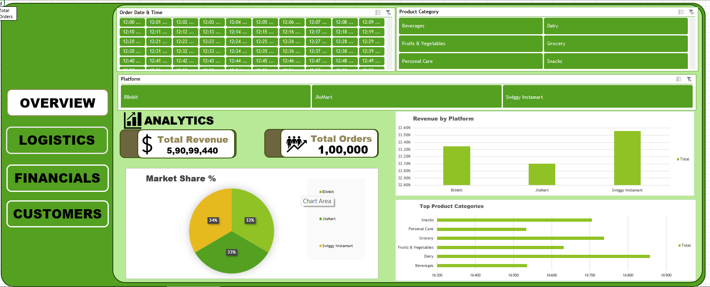

# Sales Business Performance Dashboard — Quick Commerce

An Excel analysis of 100,000 quick-commerce orders across Blinkit, JioMart, and Swiggy Instamart — revenue, platform share, product categories, delivery, and customer feedback.

## What this analysis answers

- How much revenue does each platform bring in, and how evenly is it split?
- Which product categories drive the most revenue?
- How do delivery time, delivery delays, and service ratings vary?
- What are customers actually saying in their feedback?

## Key findings

- **100,000 orders** analysed, with **total revenue of ₹59,099,440**
- **Revenue by platform:** Swiggy Instamart ₹19,831,984 · Blinkit ₹19,705,084 · JioMart ₹19,562,372 — an almost even three-way split
- **Top categories by revenue:** Personal Care ₹17,395,601 · Grocery ₹14,194,055 · Beverages ₹9,086,669 · Dairy ₹7,610,522 · Fruits & Vegetables ₹6,246,517
- The workbook includes dedicated LOGISTICS, FINANCIAL, and CUSTOMER analysis sheets, plus the DASHBOARD view
- Every order carries platform, product category, order value, delivery time, delivery delay, service rating, and customer feedback

## Tools used

- **Microsoft Excel** — PivotTables, formulas, and dashboard design
- **Data Analysis** — 100,000-row order-level aggregation by platform, category, delivery, and customer

## Files

| File | Description |
| --- | --- |
| `sales-business-performance-dashboard.xlsx` | The complete Excel workbook — 100,000 orders with platform, category, delivery, and feedback data, plus PivotTables and the DASHBOARD, LOGISTICS, FINANCIAL, and CUSTOMER sheets |
| `sales-business-performance-dashboard.png` | Dashboard screenshot |

## How to open it

1. Download `sales-business-performance-dashboard.xlsx`
2. Open it in Microsoft Excel
3. Start on the `DASHBOARD` sheet, then explore the LOGISTICS, FINANCIAL, and CUSTOMER sheets

## About me

**Dinesh Karthik** — Aspiring Data Analyst | SQL · Power BI · Python · Excel

Final-year B.Tech Computer Science student, graduating 2027, seeking entry-level Data Analyst roles in India.

- LinkedIn: https://www.linkedin.com/in/dinesh-karthik-732a882bb/
- Portfolio: https://portfilo-lime-two.vercel.app/
- GitHub: https://github.com/dineshkarthik14322
